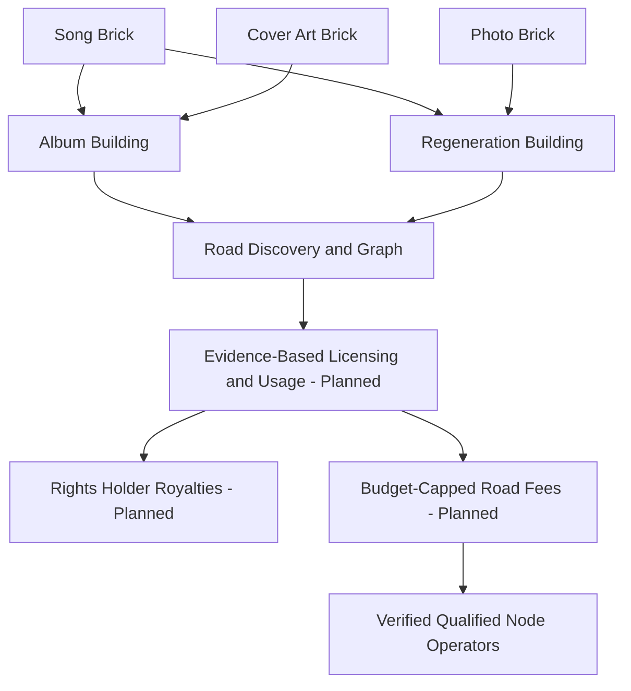

# Architecture: The Yellow Brick Road

**IP objects first, products second.** Each registered IP is an independently deployed contract (a *Yellow Brick*). The chain-specific contract address is its economic identity; the content/identity commitment is kept separate to support portability and disputes.

### The components

| Layer | Role |
|---|---|
| Yellow Brick | Unique contract for content hash, identity claim, originator, controller, versioned metadata |
| Brick Factory | EIP-1167 CREATE2 deployment; no additional registration charge beyond EVM gas |
| Buildings | Album, anthology, catalogue, dataset, regeneration: typed references to independent bricks |
| Road | Open discovery, relationship indexes, verifiable usage and royalty interoperability (planned) |
| Road node | Qualifying blockchain node PLUS measured indexing/verification service; not a brick contract |
| Utility treasury | Community-budget-capped settlement microfees for service operators (planned) |

Membership does not prove ownership, grant a license, transfer copyright or confer royalty rights. Controller privileges refer only to the deployed object. The contract does not claim that hashing or IP registration legally proves ownership.

Usage accounting should employ versioned license records and authenticated, replay-resistant events; off-chain logs may be committed on-chain using Merkle roots. An AI vendor's own usage statements are attestations, not proof of causal influence of all training data on every model output. An output's derivation edges require traceable evidence.

**Security:** clone initialization should be atomic, the template implementation initialization locked, permissions explicit, identifiers domain-separated, and source commitments immutable. The three current contracts are prototypes, not licensed-settlement or money-holding implementations.
